# UI/UX Design

Bu bo‘lim `integration/v1` implementation auditidan olingan haqiqiy React ekranlarini ko‘rsatadi. Screenshotlardagi ism, buyurtma va summalar test/demo fixture bo‘lib, real mijoz ma’lumoti emas.

## Dizayn manbasi va holat

- **Actual React UI:** ushbu papkadagi `*-react.png` rasmlar.
- **HTML design prototype:** private design manbada saqlanadi; public repo’ga source ko‘chirilmagan.
- **Partial:** Owner Dashboard/Reports vizuali mavjud, ammo real aggregation endpoint integratsiyasi yakuniy dalil talab qiladi.
- **Current:** POS order/payment/shift/daily flow va TV ekrani.

## Asosiy ekranlar

### Pairing va PIN

| Pairing | PIN |
|---|---|
| 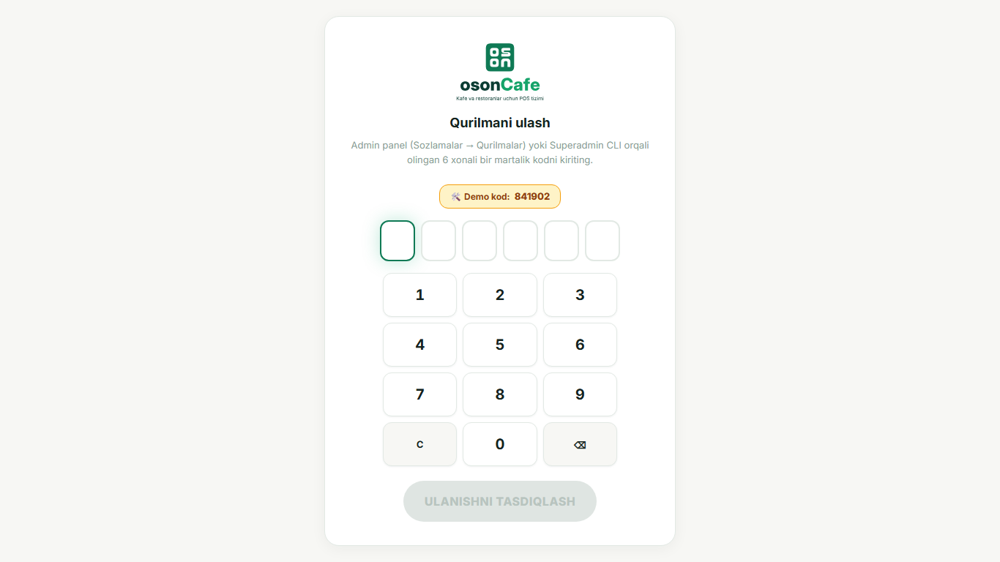 | 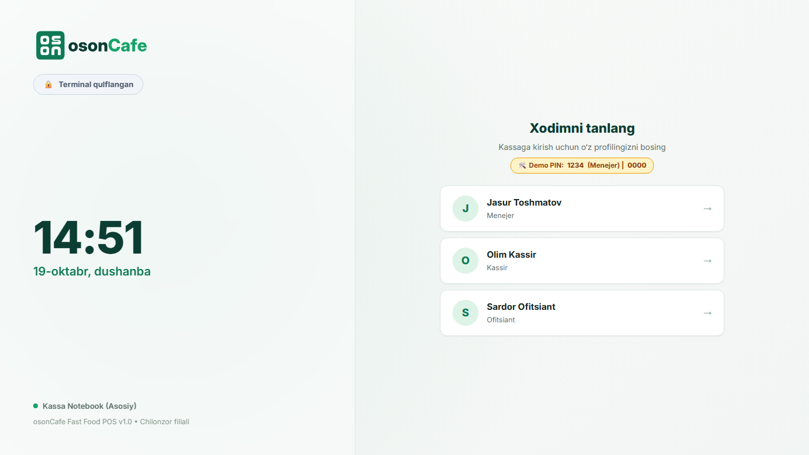 |

### POS va to‘lov

| POS order | Payment |
|---|---|
| 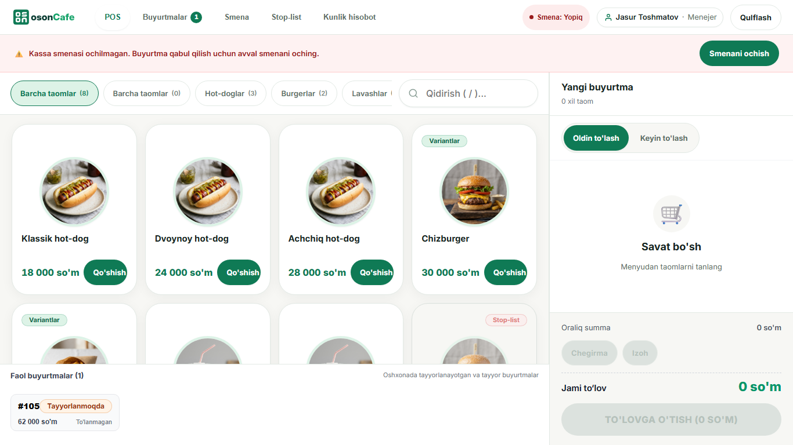 | 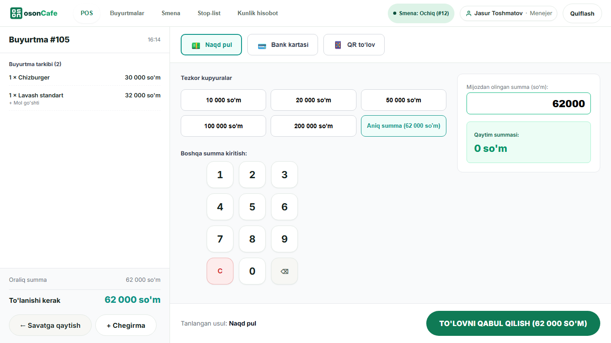 |

### Buyurtma, smena va hisobot

| Orders | Shift |
|---|---|
| 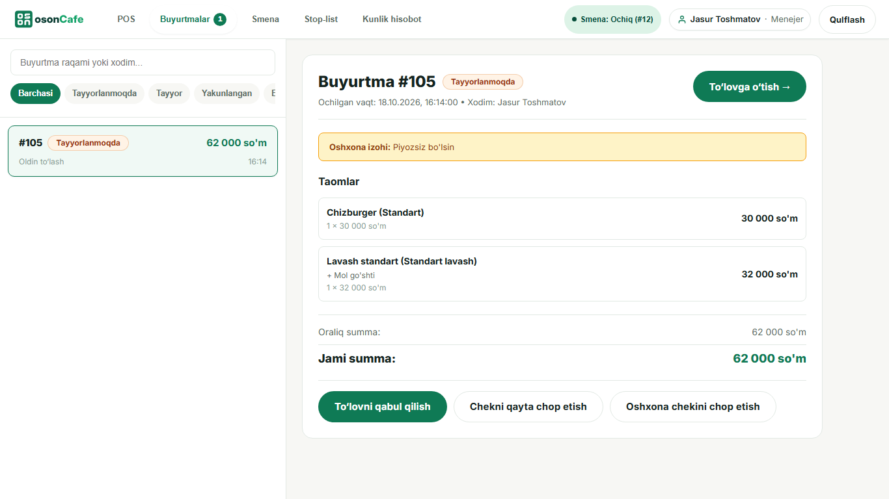 | 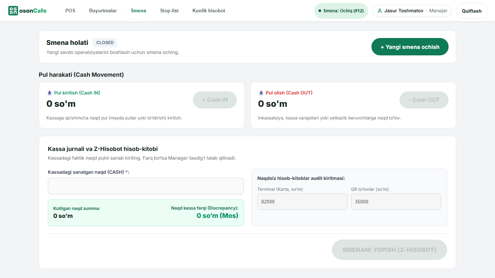 |

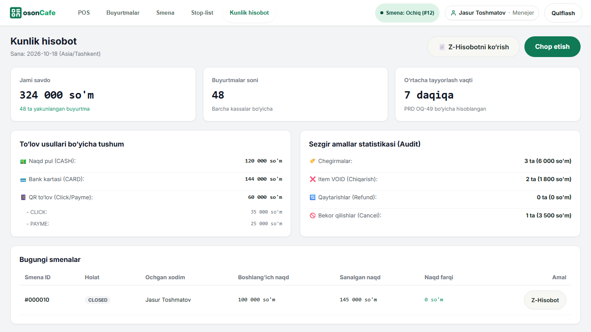

### TV va Owner Admin

| TV | Owner Dashboard |
|---|---|
| 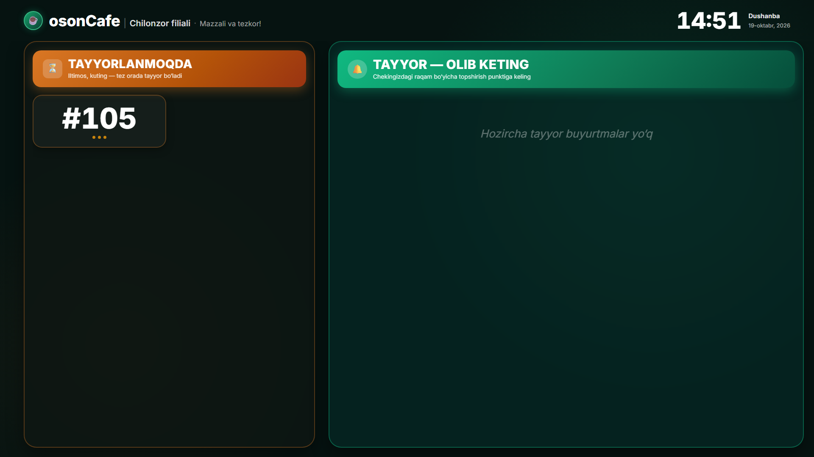 | 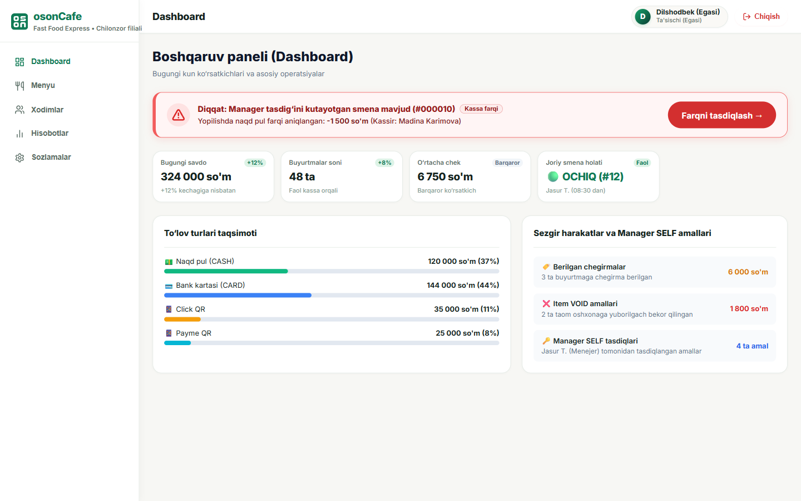 |

| Menu | Employees | Settings |
|---|---|---|
| 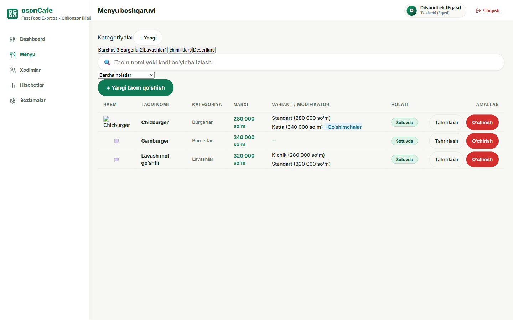 | 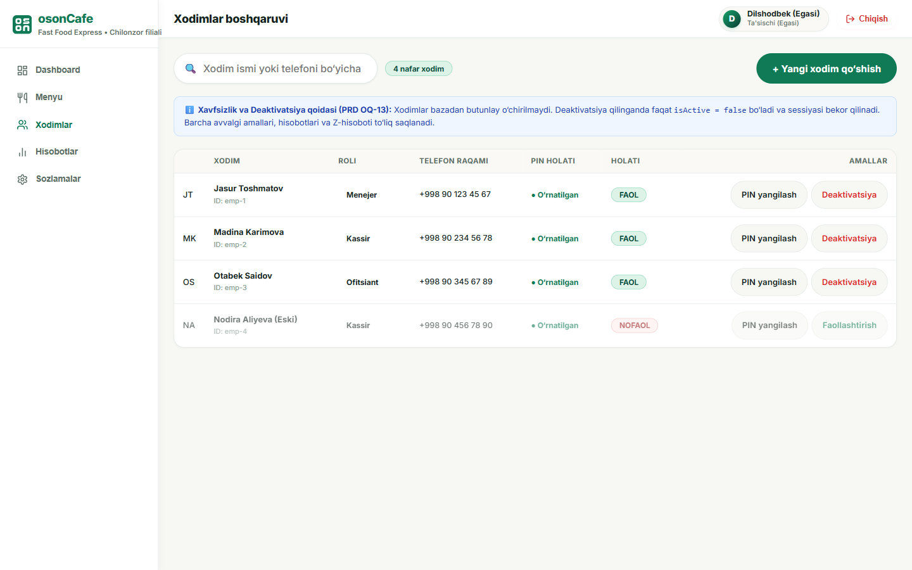 | 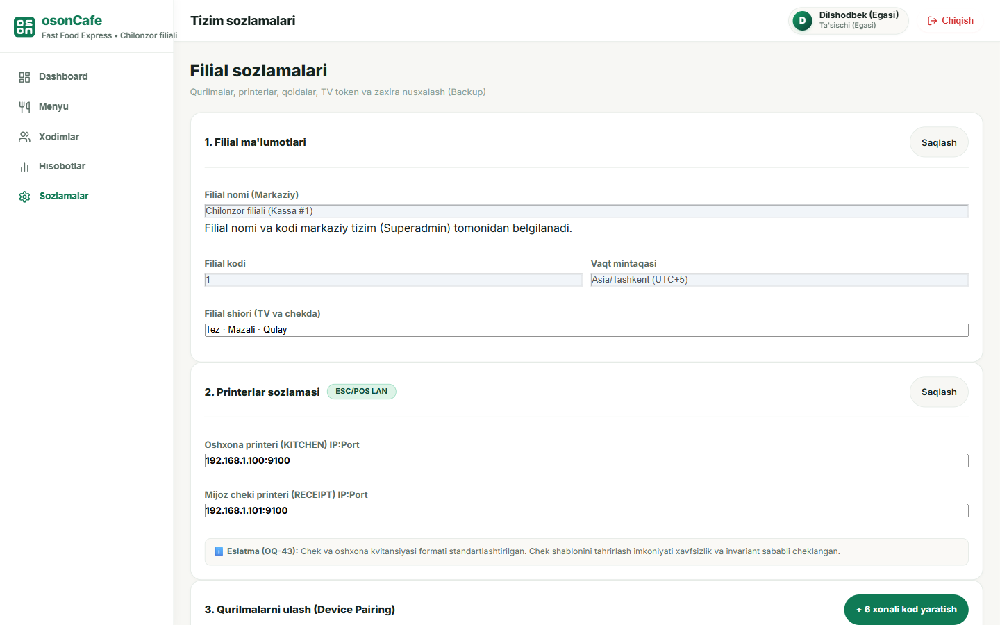 |

## UI quality mezonlari

- Inter typography, 4/8 px spacing ritmi va osonCafe green tokenlari.
- Normal text kontrasti kamida 4.5:1.
- Tugma/touch target’lar mobile’da kamida 44 px.
- Keyboard focus ko‘rinadi; interaction faqat rangga bog‘lanmaydi.
- 360/390/768 va desktop layout’lar gorizontal scrollsiz ishlaydi.
- Error sabab va recovery action bilan field/flow yaqinida ko‘rsatiladi.
- Dark TV ekrani alohida kontekst; POS/Admin light surface’dan ataylab farq qiladi.

Route va holatlar: [UI Inventory](UI-Inventory.md).
