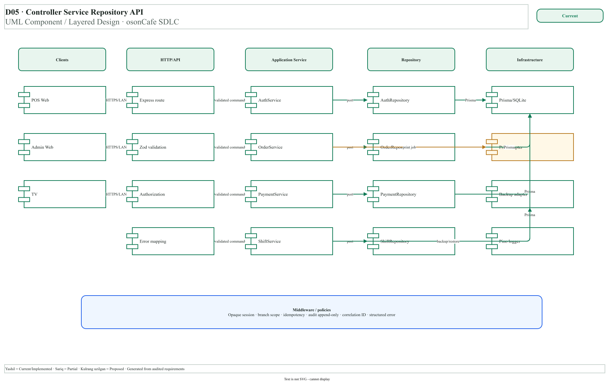

# Implementatsiya arxitekturasi

## Monorepo qatlamlari

| Qatlam | Vazifa |
|---|---|
| `apps/hub` | Express API, application service, repository, Prisma, operational adapter |
| `apps/pos-web` | POS, order, payment, shift, daily report va TV React client |
| `apps/admin-web` | OWNER authentication, menu, employee, reports va settings React client |
| `packages/domain` | Money, order, payment, discount va shift qoidalari |
| `packages/shared-types` | API DTO, enum, endpoint va error contract |
| `design` | Brand token, HTML prototype va UI QA materiallari |
| `deploy` / `scripts` | Windows package, service/autostart va deployment yordamchilari |

## Request lifecycle

1. React client typed request yaratadi.
2. Express route Zod bilan validate qiladi.
3. Opaque session, role va Branch scope tekshiriladi.
4. Application service domain qoidalarini qo‘llaydi.
5. Repository Prisma transaction bajaradi.
6. Audit/idempotency/logging cross-cutting qatlamlari natijani qayd etadi.
7. Shared error envelope client’ga qaytariladi.

## Dependency qoidasi

- UI database’ga bevosita ulanmaydi.
- Route business logic yoki raw SQL saqlamaydi.
- Domain package Express/React/Prisma’ga bog‘lanmaydi.
- Shared types runtime secret yoki database client export qilmaydi.
- Print va backup tashqi adapter sifatida ajratiladi.
