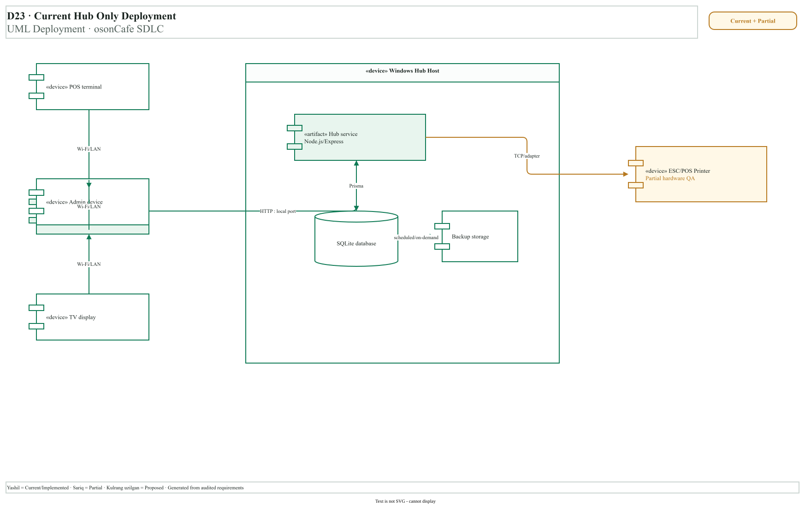

# Current Hub-Only Deployment

## Node’lar

- Windows Hub host: Node.js service, static POS/Admin/TV artefaktlari, SQLite.
- LAN router: client’lar va Hub o‘rtasidagi local connectivity.
- POS/Admin/TV: Chromium-compatible browser/PWA.
- Backup storage: local yoki nazoratli tashqi joy.
- ESC/POS printer: adapter bor, fizik hardware QA **Partial**.

## Deployment flow

1. Windows prerequisit va portlar tekshiriladi.
2. Hub package o‘rnatiladi; `.env` xavfsiz lokal konfiguratsiya sifatida yaratiladi.
3. Database generate/migration/seed nazoratli bajariladi.
4. Service/autostart ro‘yxatdan o‘tadi.
5. Health endpoint va local URL tekshiriladi.
6. Device pairing, login va smoke flow bajariladi.
7. Backup yaratiladi va restore instruktsiyasi tekshiriladi.

## Rollback

- Binary/config oldingi paketga qaytariladi.
- Database destructive rollback’dan oldin safety backup olinadi.
- Restore’dan keyin health, auth, menu va order read tekshiriladi.

