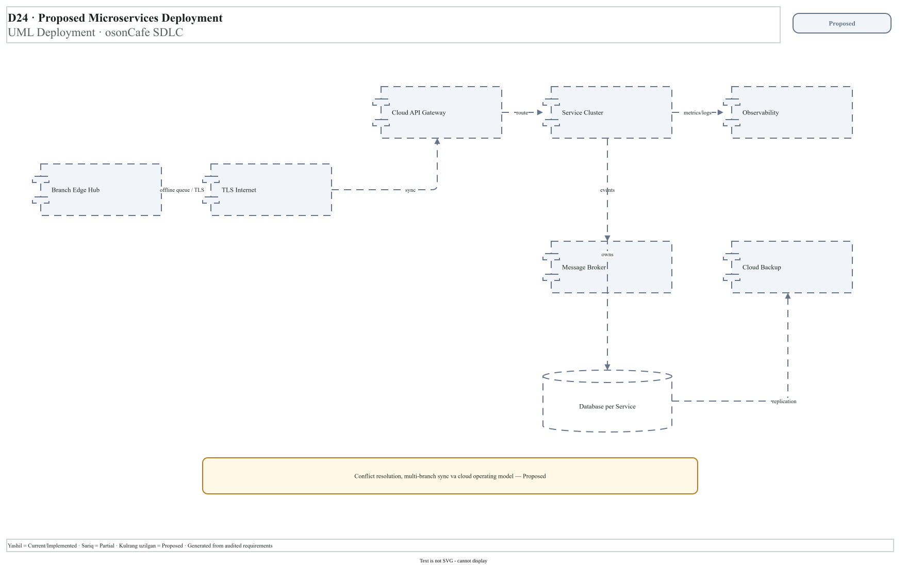

# Proposed Microservices Deployment

Bu kelajak konsepsiyasi; joriy pilot emas.

## Proposed node’lar

- Branch Edge Hub va offline queue.
- TLS secure sync channel.
- Cloud API Gateway.
- Identity, Catalog, Sales, Operations va Reporting service cluster.
- Message broker va domain events.
- Database per Service.
- Central observability va cloud backup.

## Migratsiya sharti

Microservice extract faqat modular monolith boundary, service ownership, sync conflict policy, operating cost va observability tayyor bo‘lganda bosqichma-bosqich bajariladi. Big-bang rewrite tavsiya qilinmaydi.

