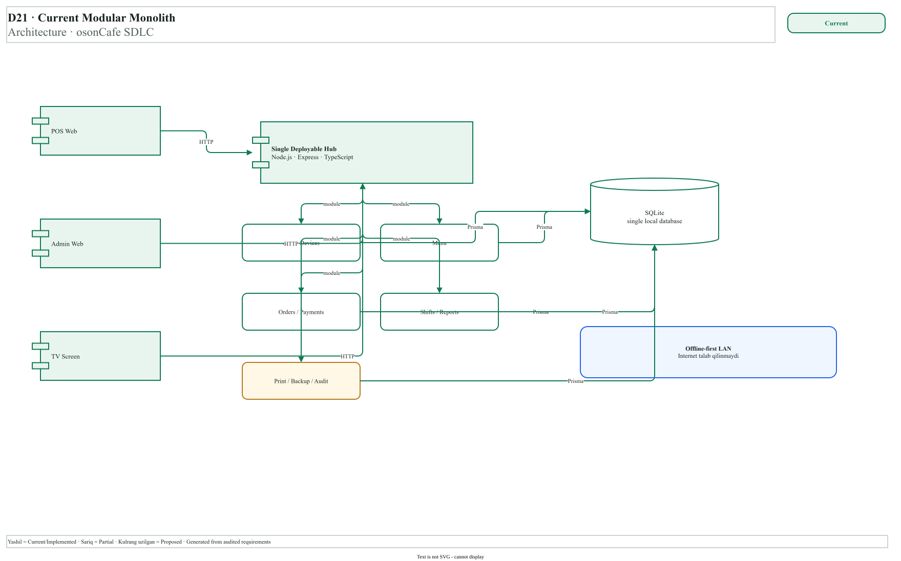
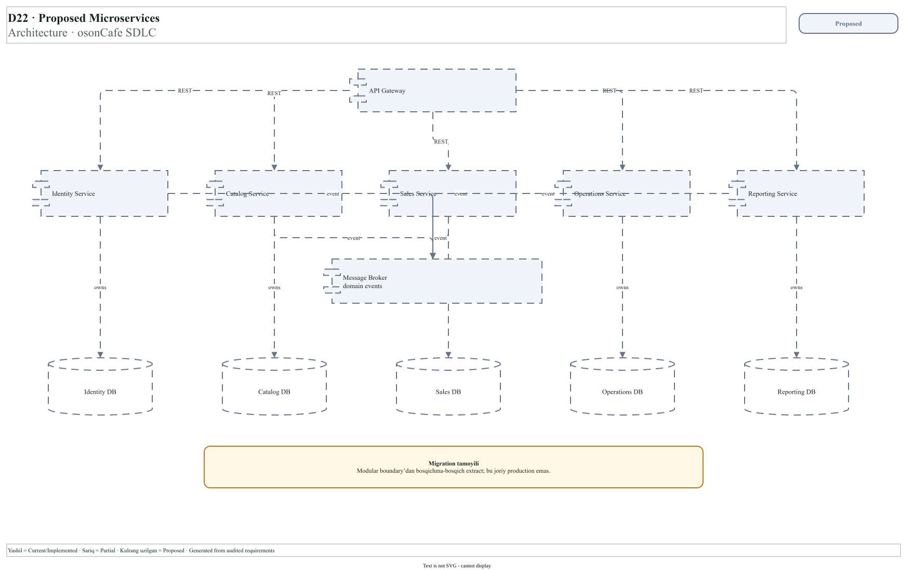
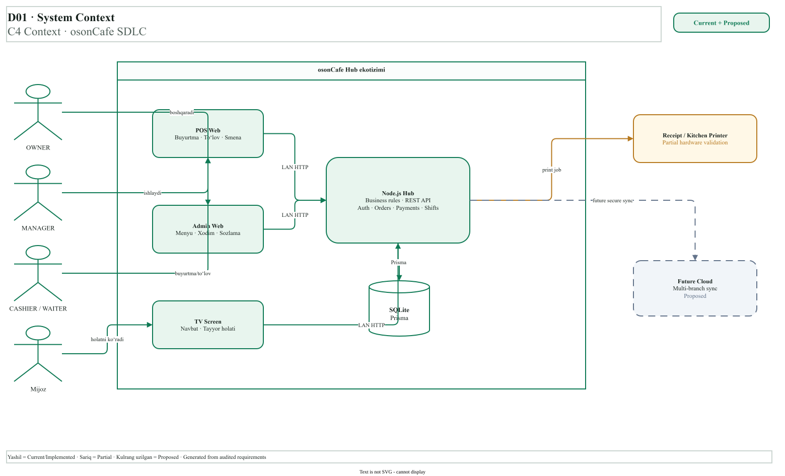
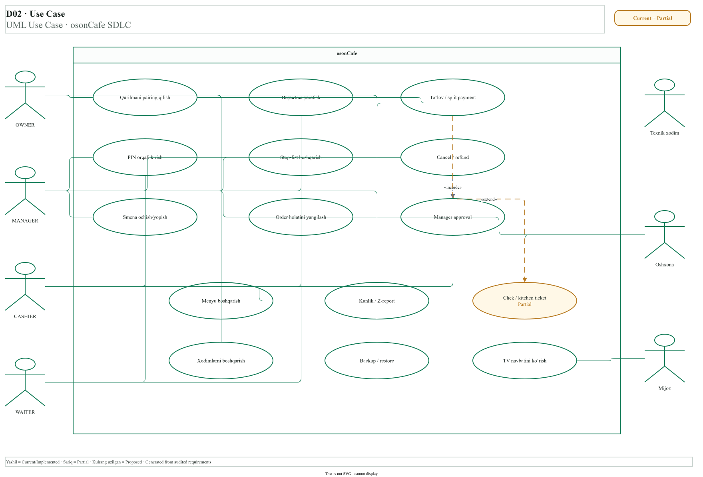
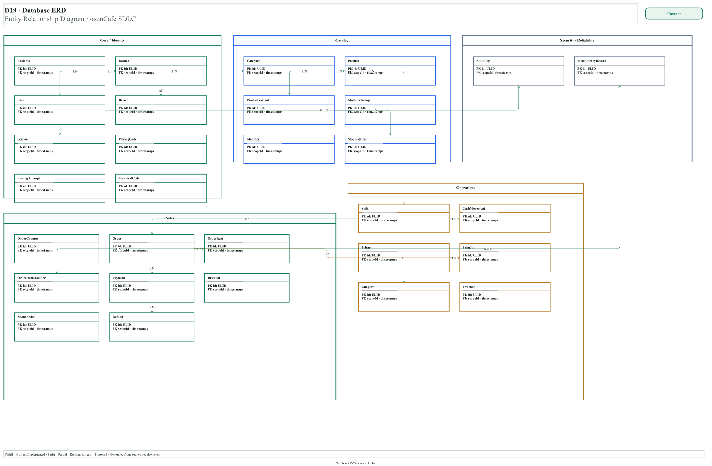
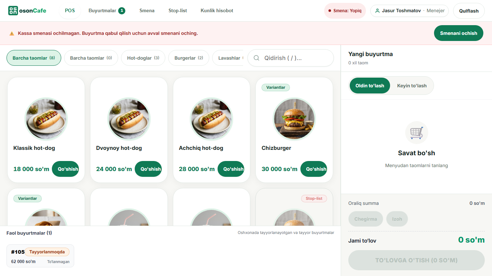
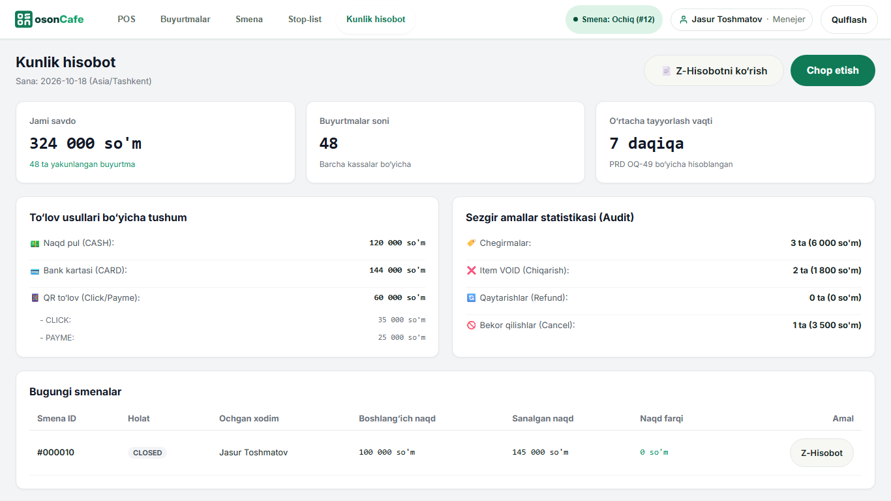
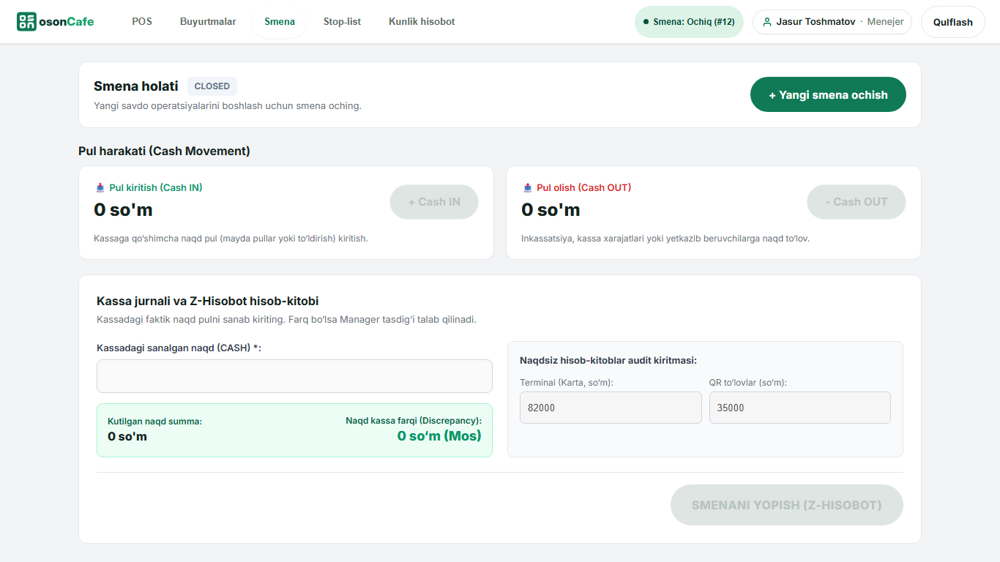
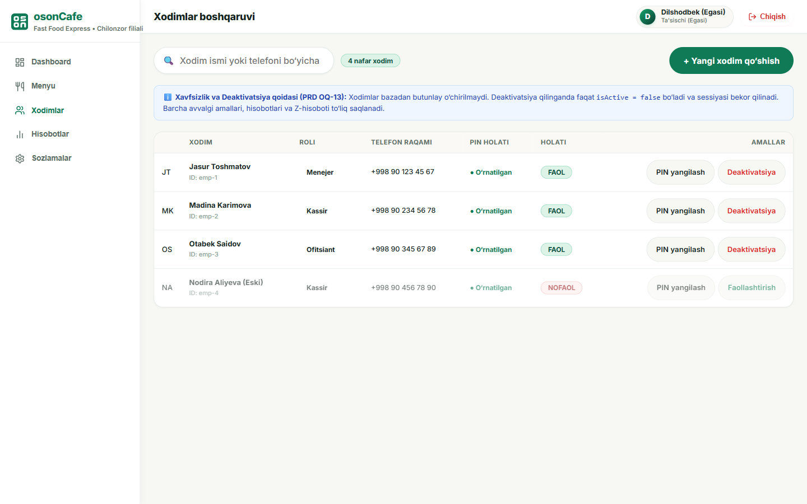

# osonCafe — SDLC, UML va dasturiy ta’minot arxitekturasi

  

Urganch davlat universiteti uchun tayyorlangan o‘quv-amaliy loyiha. Repository osonCafe restoran POS tizimining talablarini, joriy modular monolith arxitekturasini, ma’lumotlar modelini, UML/BPMN diagrammalarini, sinov dalillarini va taklif etilayotgan microservices evolyutsiyasini yagona hujjatlar to‘plamida jamlaydi.

## Loyiha pasporti

| Maydon | Qiymat |
|---|---|
| Talaba | Matyaqubov Dilshodbek |
| Guruh | S941-23Di |
| O‘qituvchi | Kuryazov D.A. |
| Loyiha | osonCafe |
| Yo‘nalish | SDLC, UML va dasturiy ta’minot arxitekturasi |
| Yil | 2026 |
| GitHub | [@dilshodxdev](https://github.com/dilshodxdev) |
| Mahsulot sayti | [osoncafe.uz](https://osoncafe.uz) |
| Yakuniy hisobot | [50 betlik PDF](Documentation/osonCafe-SDLC-Architecture.pdf) |

## Holat semantikasi

| Holat | Mazmuni |
|---|---|
| **Current / Implemented** | Private implementation auditi va testlar bilan tasdiqlangan joriy imkoniyat |
| **Partial** | Qisman mavjud yoki fizik muhitda yakuniy tekshiruv talab qiladigan imkoniyat |
| **Proposed** | Kelajak arxitekturasi yoki rejalashtirilgan imkoniyat; joriy tizim sifatida taqdim etilmaydi |

Joriy pilot — Windows Hub, POS, Admin va TV ilovalarini birlashtirgan offline-first modular monolith. Taklif etilayotgan model — Identity, Catalog, Sales, Operations va Reporting servislariga ajratilgan evolyutsion microservices arxitekturasi.

## Muammo va yechim

Kafe va kichik restoranlarda buyurtma, kassa, oshxona, smena va hisobot jarayonlarining alohida yuritilishi xizmatni sekinlashtiradi va moliyaviy nazoratni murakkablashtiradi. osonCafe bu jarayonlarni lokal Hub atrofida birlashtiradi: internet bo‘lmasa ham LAN ichida savdo davom etadi, rollar va ruxsatlar boshqariladi, moliyaviy amallar audit iziga ega bo‘ladi.

## Asosiy imkoniyatlar

- PIN/session va device pairing;
- menyu, variant, modifier va stop-list;
- buyurtma yaratish, oshxona oqimi va TV queue;
- naqd, karta, QR va split payment;
- cancel/refund va manager approval;
- smena, cash movement, Z-report va kunlik hisobot;
- audit log, backup/restore va Windows Hub deployment.

## Asosiy arxitektura

| Joriy modular monolith | Taklif etilayotgan microservices |
|---|---|
|  |  |

Muhim qarorlar va chegaralar [Architecture Decisions](02-System-Design/Architecture-Decisions.md), [Architecture Overview](02-System-Design/Architecture-Overview.md) va [Proposed Deployment](10-Deployment/Proposed-Microservices.md) hujjatlarida izohlangan.

## Talablar va modellar

- [Functional Requirements](01-Requirements/Functional-Requirements.md) — FR-01…FR-30.
- [Non-Functional Requirements](01-Requirements/Non-Functional-Requirements.md) — NFR-01…NFR-16.
- [User Stories](01-Requirements/User-Stories.md) — US-01…US-18.
- [Business Rules](01-Requirements/Business-Rules.md) — BR-01…BR-22.
- [Acceptance Criteria](01-Requirements/Acceptance-Criteria.md) va [RTM](01-Requirements/Traceability-Matrix.md).
- [Use Case Descriptions](02-System-Design/Use-Case-Descriptions.md) va [Data Dictionary](03-Database/Data-Dictionary.md).

| System context | Use case | Database ERD |
|---|---|---|
|  |  |  |

## Diagrammalar

Repositoryda 27 ta diagrammaning har biri uch formatda berilgan:

- `.drawio` — tahrirlanadigan source of truth;
- `.svg` — GitHub va web uchun vektor preview;
- `.png` — PDF va universal raster fallback.

Jami: **27 × 3 = 81 diagramma artefakti**. To‘liq ro‘yxat [Diagram Registry](02-System-Design/Diagram-Registry.md) va [04-Diagrams](04-Diagrams/README.md) bo‘limida.

## UI namunalar

Quyidagi rasmlar audit qilingan test fixture ma’lumotlari bilan olingan public-safe UI dalillaridir.

| POS buyurtma | Kunlik hisobot | Smena | Xodimlar |
|---|---|---|---|
|  |  |  |  |

Barcha 12 screenshot va ularning statusi [UI evidence](05-UI/README.md) hujjatida berilgan.

## Implementatsiya va texnologiyalar

Joriy implementation private repositoryda saqlanadi; bu public repository source kodni ko‘chirmaydi, faqat audit qilingan arxitektura va natijalarni hujjatlashtiradi.

| Qatlam | Texnologiyalar |
|---|---|
| Desktop/Hub | Electron, Node.js, TypeScript |
| Frontend | React, Vite, React Router, TanStack Query |
| Backend | Fastify, Zod, controller–service–repository qatlamlari |
| Ma’lumotlar | Prisma ORM, SQLite, 30 model |
| Xavfsizlik | PIN/session modeli, Argon2id, role/permission tekshiruvi |
| Test va sifat | Vitest, Playwright, ESLint, Prettier, TypeScript |
| Monorepo | pnpm workspaces, Turborepo |

Batafsil: [Implementation Architecture](06-Implementation/Architecture.md), [Frontend](06-Implementation/Frontend-Architecture.md), [Backend](06-Implementation/Backend-Architecture.md), [Security](06-Implementation/Security-Validation-Logging.md) va [API Structure](06-Implementation/API-Structure.md).

## Test natijalari

2026-11-13 kuni audit qilingan private `integration/v1` branch’da production tekshiruvlari bajarildi:

| Tekshiruv | Natija |
|---|---|
| Invariant scan | 434 source file, PASS |
| Typecheck/lint/format | PASS |
| Unit/integration testlar | 269 test file, **1780 passed, 0 failed** |
| Production build | Hub, POS, Admin, domain va shared packages — PASS |
| Smoke test dalili | 18/18 PASS |
| Visual regression dalili | 95/95 PASS |

Fizik printer E2E, performance p95 benchmark va Admin real aggregation E2E hali **Partial / Not run**. Tafsilotlar [Test Report](07-Testing/Test-Report.md) va [Test Strategy and Evidence](07-Testing/Test-Strategy-and-Evidence.md) da.

## Deployment

- [Current Hub-only deployment](10-Deployment/Current-Hub-Only.md) — joriy offline-first LAN modeli.
- [Proposed microservices deployment](10-Deployment/Proposed-Microservices.md) — kelajak uchun taklif, production holati emas.
- [Deployment overview](10-Deployment/README.md) — konfiguratsiya, backup va release chegaralari.

## Repository tuzilmasi

| Papka | Mazmuni |
|---|---|
| `01-Requirements/` | Talablar, user story, biznes qoidalari, acceptance criteria va RTM |
| `02-System-Design/` | Arxitektura, use case tavsiflari va diagrammalar katalogi |
| `03-Database/` | Prisma modeli, ERD va data dictionary |
| `04-Diagrams/` | 27 diagrammaning `.drawio`, `.svg`, `.png` artefaktlari |
| `05-UI/` | 12 public-safe UI screenshot va izohlar |
| `06-Implementation/` | Frontend, backend, API, security va code sample hujjatlari |
| `07-Testing/` | Test plan, 20 test case, report va dalillar |
| `08-SDLC/` | Rejalashtirishdan maintenance’gacha bo‘lgan lifecycle |
| `09-References/` | Manbalar, glossary, standartlar va evidence manifest |
| `10-Deployment/` | Joriy va taklif etilayotgan deployment modeli |
| `Documentation/` | Akademik PDF va change log |

## SDLC

[Development Lifecycle](08-SDLC/Development-Lifecycle.md) hujjati planning, requirements, design, implementation, testing, deployment va maintenance bosqichlarini tavsiflaydi. [Repository and Version Control](08-SDLC/Repository-and-Version-Control.md) branch, commit va release qoidalarini belgilaydi.

## Maxfiylik

Public repositoryda token, parol, real mijoz ma’lumoti, private repository URL’i yoki private source kod yo‘q. Shaxsiy email README va hujjatlarga kiritilmagan. Yakuniy tekshiruv natijalari [AUDIT.md](AUDIT.md) da.
